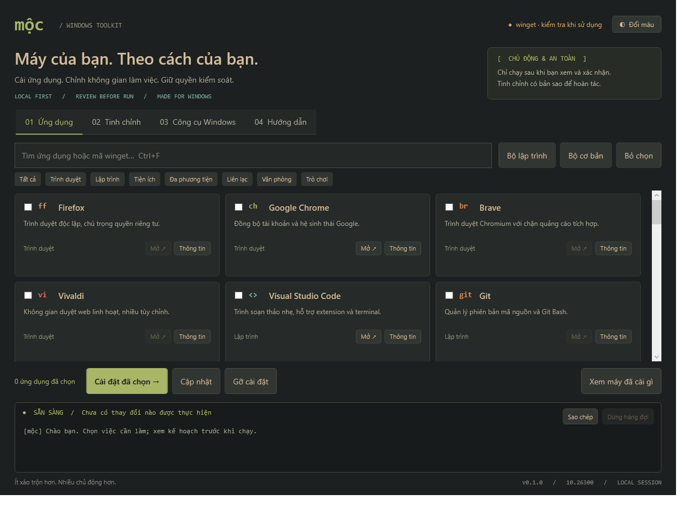

# Mộc — bộ công cụ Windows tiếng Việt

Mộc là một ứng dụng nhỏ giúp bạn cài phần mềm, chỉnh vài thiết lập Windows và mở nhanh các công cụ hệ thống, tất cả trong một cửa sổ tiếng Việt. Cách gom công cụ học theo [Chris Titus WinUtil](https://github.com/ChrisTitusTech/winutil), màu sắc lấy cảm hứng từ [Omarchy](https://omarchy.org/). Mã được viết lại từ đầu, không sao chép code hay thương hiệu của hai dự án đó.

Mình làm Mộc theo một nguyên tắc: **không có gì chạy khi bạn chưa xem và đồng ý**. Lệnh nào cũng hiện ra trước, tinh chỉnh nào cũng có bản sao để quay lại.

> **Phiên bản 0.1.0** — bản đầu tiên, chạy được nhưng còn mới. Chưa ký số, chưa thử installer thật trên máy ảo. Nên đọc phần [Giới hạn](#giới-hạn-cần-biết) trước khi dùng trên máy quan trọng.



## Cài và chạy

### Cách 1: một dòng lệnh (khuyên dùng)

Mở **CMD** hoặc **PowerShell** bằng tài khoản thường (không cần "Run as administrator") rồi dán:

```bat
powershell -NoProfile -Command "[Net.ServicePointManager]::SecurityProtocol=3072; irm https://github.com/Dalziel66/arch-tool-vn-pro/releases/latest/download/install.ps1 | iex"
```

Lệnh này sẽ:

1. Tải `install.ps1` từ [trang Releases](https://github.com/Dalziel66/arch-tool-vn-pro/releases).
2. Tải `MocToolkit-0.1.0.zip`, tự thử lại tối đa 3 lần nếu mạng chập chờn.
3. **So mã SHA256** của file zip với mã đã ghi sẵn trong `install.ps1`. Không khớp là dừng ngay: không giải nén, không chạy gì.
4. Giải nén vào `%LOCALAPPDATA%\MocToolkit\app\0.1.0`, không cần quyền quản trị.
5. Mở Mộc.

Muốn cài lại hoặc sửa bản bị hỏng, cứ chạy lại đúng lệnh đó. Nhật ký và bản sao tinh chỉnh của bạn không bị xóa.

> Đoạn `SecurityProtocol=3072` bật TLS 1.2. Thiếu nó, một số máy Windows 10 cũ sẽ bị GitHub từ chối kết nối.
>
> `irm | iex` nghĩa là bạn tin tài khoản GitHub chứa release này. Mã SHA256 bảo vệ file zip, nhưng không bảo vệ chính `install.ps1`. Muốn chắc chắn thì mở link `install.ps1` ra đọc trước, nó chỉ khoảng 60 dòng.

### Cách 2: tải thủ công

1. Vào [Releases](https://github.com/Dalziel66/arch-tool-vn-pro/releases), tải `MocToolkit-0.1.0.zip`.
2. Giải nén ra bất kỳ đâu.
3. Mở `Moc.exe`. Giữ nguyên các thư mục `src`, `data` và file `Start-Moc.ps1` bên cạnh nó.

File tải từ Internet và chưa ký số nên Windows có thể hỏi lại hoặc chặn. Cách xử lý an toàn có trong [USER-GUIDE](docs/USER-GUIDE.md). **Đừng tắt SmartScreen hay Defender** chỉ để chạy Mộc.

### Cách 3: từ mã nguồn

```bat
git clone https://github.com/Dalziel66/arch-tool-vn-pro.git
cd arch-tool-vn-pro
Start-Moc.cmd
```

### Yêu cầu

- Windows 11 x64 (đã thử). Windows 10 có PowerShell 5.1 nhiều khả năng chạy được nhưng chưa thử.
- **App Installer / winget** từ Microsoft Store, cần để cài phần mềm. Thiếu winget thì Mộc vẫn mở, chỉ báo lỗi khi bạn bấm cài.
- Không cần Node, Python, .NET SDK hay thư viện nào khác.

## Mộc làm được gì

| Tab | Bạn làm được gì | Ghi chú |
| --- | --- | --- |
| **Ứng dụng** | Tìm, chọn nhiều, cài / cập nhật / gỡ 36 phần mềm phổ biến qua winget; xem thông tin gói; xem máy đã cài gì | Có sẵn "Bộ lập trình" và "Bộ cơ bản". Gỡ cài đặt phải gõ `GO` để xác nhận |
| **Tinh chỉnh** | Hiện đuôi tệp, bật chế độ tối cho ứng dụng, tắt hiệu ứng trong suốt | Chỉ đổi tài khoản hiện tại (HKCU). Nút Hoàn tác trả về đúng giá trị cũ |
| **Công cụ Windows** | Windows Update, Storage, Startup apps, Installed apps, Task Manager, System Protection, SFC, DISM | SFC/DISM hỏi UAC riêng; Mộc không bao giờ tự khởi động lại máy |
| **Hướng dẫn** | Mở tài liệu, mở thư mục nhật ký và bản sao | |

Danh mục có trình duyệt (Firefox, Chrome, Brave, Vivaldi), lập trình (VS Code, Git, Node.js LTS, Python 3.14, Windows Terminal, PowerShell 7, Docker…), tiện ích (7-Zip, PowerToys, Everything, ShareX, Bitwarden…), đa phương tiện (VLC, OBS, Spotify, GIMP, Blender…), liên lạc, văn phòng và trò chơi. Danh sách đầy đủ ở [data/apps.json](data/apps.json).

Winget luôn cài **bản mới nhất** của mỗi gói tại thời điểm bạn bấm cài. Mộc không ghim phiên bản, trừ Python và GIMP vì winget tách gói theo phiên bản chính.

Nút **Mở ↗** chỉ sáng khi Mộc tìm thấy ứng dụng ở thư mục cài mặc định và file có chữ ký số hợp lệ. Nút mờ **không** có nghĩa là chưa cài; có thể bạn cài ở chỗ khác hoặc từ Store. Hãy dùng "Xem máy đã cài gì" hoặc Start Menu.

## Những gì Mộc cố tình không làm

- Không tắt Defender, Firewall, UAC, SmartScreen hay Windows Update.
- Không "debloat" hàng loạt, không sửa dịch vụ, không xóa dữ liệu.
- Không tự nâng quyền cả ứng dụng. Chỉ installer hoặc công cụ nào cần mới hỏi UAC.
- Không nhận lệnh shell do người dùng gõ. Lệnh winget luôn có dạng cố định `--id <mã> --exact --source winget`.
- Không gửi telemetry. Winget và các phần mềm bạn cài có kết nối mạng của riêng chúng.
- Bên trong Mộc không tải script về để chạy và không tự cập nhật. Lệnh `irm` ở trên là do **bạn** chủ động chạy.

Nút **Dừng hàng đợi** chỉ bỏ các mục chưa chạy. Installer đang chạy sẽ được để chạy xong, vì ngắt ngang dễ làm hỏng bản cài.

## Giới hạn cần biết

- **Chưa ký số.** `SHA256SUMS.txt` giúp kiểm tra file không bị sửa, nhưng không chứng minh ai là người phát hành.
- **Chưa thử installer thật trên máy ảo.** Mới chỉ kiểm tra được rằng 36 mã gói vẫn còn trên winget.
- Tinh chỉnh có hoàn tác; **cài / gỡ / cập nhật phần mềm và SFC/DISM thì không**. Nên tạo restore point (tab Công cụ → System Protection) trước khi sửa hệ thống.
- Nút Đổi màu hiện chỉ đổi nền Gruvbox ↔ Jade, chưa phải bộ theme đầy đủ.
- Chưa thử trên Windows 10, ARM64, Windows Server hay máy doanh nghiệp có Group Policy.

Không phần mềm nào an toàn tuyệt đối, và installer của bên thứ ba vẫn có quyền riêng của nó. Chi tiết trong [SECURITY.md](docs/SECURITY.md).

## Mộc lưu dữ liệu ở đâu

| Đường dẫn | Nội dung |
| --- | --- |
| `%LOCALAPPDATA%\MocToolkit\app\<phiên bản>` | Bản cài từ lệnh `irm` |
| `%LOCALAPPDATA%\MocToolkit\audit-YYYY-MM.jsonl` | Nhật ký mọi thao tác, mỗi dòng một bản ghi JSON |
| `%LOCALAPPDATA%\MocToolkit\backups\` | Bản sao giá trị gốc của từng tinh chỉnh |

Muốn gỡ Mộc: hoàn tác các tinh chỉnh trước (nếu cần), rồi xóa thư mục `%LOCALAPPDATA%\MocToolkit`. Mộc không ghi gì vào Program Files hay registry của máy.

## Gặp lỗi?

| Lỗi | Cách xử lý |
| --- | --- |
| `The request was aborted: The connection was closed unexpectedly` | Lệnh thiếu đoạn `SecurityProtocol=3072`, hoặc URL release sai. Chép lại đúng lệnh ở trên |
| `SHA256 khong khop` | File zip trên release khác với bản mà `install.ps1` mong đợi. Đừng chạy tiếp; báo lại cho người phát hành |
| `Chưa có App Installer` | Cài hoặc cập nhật **App Installer** từ Microsoft Store rồi mở lại Mộc |
| `running scripts is disabled` | Mở bằng `Moc.exe` hoặc `Start-Moc.cmd`; chúng chỉ đặt `RemoteSigned` cho riêng tiến trình Mộc, không đổi thiết lập máy |
| `Mộc đang mở` | Mộc chỉ cho phép một cửa sổ, để hai cửa sổ không cùng sửa bản sao tinh chỉnh |

Thêm các trường hợp khác trong [USER-GUIDE.md](docs/USER-GUIDE.md).

## Dành cho người phát triển

Chạy test, luôn bằng **Windows PowerShell 5.1** chứ không phải PowerShell 7:

```powershell
powershell.exe -NoProfile -ExecutionPolicy RemoteSigned -File .\scripts\Test.ps1 -IncludeUI
```

Test dùng registry giả trong bộ nhớ, không cài gì và không sửa máy thật. `-IncludeUI` mở giao diện để kiểm tra rồi chụp ảnh vào `artifacts/moc-preview.png`.

Kiểm tra môi trường và danh mục (chỉ đọc, có dùng mạng):

```powershell
powershell.exe -NoProfile -ExecutionPolicy RemoteSigned -File .\scripts\Check-Environment.ps1
powershell.exe -NoProfile -ExecutionPolicy RemoteSigned -File .\scripts\Verify-Catalog.ps1
```

### Phát hành bản mới

```powershell
powershell.exe -NoProfile -ExecutionPolicy RemoteSigned -File .\scripts\Build.ps1 -Repo Dalziel66/arch-tool-vn-pro
```

Lệnh trên tạo `dist\MocToolkit-<phiên bản>.zip` và `dist\install.ps1` (đã ghi sẵn URL và SHA256 của zip). Tạo release trên GitHub và **đính kèm cả hai file**:

```bash
gh release create v0.1.0 dist/MocToolkit-0.1.0.zip dist/install.ps1 --title "Mộc 0.1.0"
```

Mỗi lần build lại, mã SHA256 thay đổi, nên phải tải lên **cả hai** file cùng lúc. Chỉ thay một file thì người dùng sẽ gặp lỗi `SHA256 khong khop`.

### Cấu trúc thư mục

| Đường dẫn | Vai trò |
| --- | --- |
| `Start-Moc.ps1`, `Start-Moc.cmd` | Điểm khởi động |
| `src/Core.ps1` | Đọc danh mục, lập lệnh winget, xác minh chữ ký và nguồn, chạy tiến trình |
| `src/Tweaks.ps1` | Tinh chỉnh registry, bản sao, hoàn tác |
| `src/UI.ps1`, `src/MainWindow.xaml` | Giao diện WPF |
| `data/apps.json` | Danh mục phần mềm, chỉ có dữ liệu, không có lệnh |
| `launcher/MocLauncher.cs` | Mã nguồn của `Moc.exe` |
| `scripts/` | Test, build, kiểm tra môi trường, mẫu `install.ps1` |
| `tests/Run-Tests.ps1` | Test offline |

Mọi hàm đều có ghi chú tiếng Việt bắt đầu bằng `[VI]`. Trước khi sửa phần chạy lệnh, hãy đọc [ARCHITECTURE](docs/ARCHITECTURE.md), [SECURITY](docs/SECURITY.md), [DEVELOPMENT](docs/DEVELOPMENT.md) và [AGENTS.md](AGENTS.md).

## Tài liệu khác

- [Hướng dẫn sử dụng và xử lý lỗi](docs/USER-GUIDE.md)
- [Mô hình an toàn, giới hạn, phục hồi](docs/SECURITY.md)
- [Kiến trúc](docs/ARCHITECTURE.md) · [Đóng góp](docs/DEVELOPMENT.md) · [Báo cáo kiểm thử](docs/TESTING.md)
- [Bàn giao và việc tiếp theo](docs/HANDOFF.md) · [Lịch sử thay đổi](CHANGELOG.md)

## Tham khảo

- [Omarchy](https://omarchy.org/): cảm hứng giao diện và bảng màu.
- [Chris Titus WinUtil](https://github.com/ChrisTitusTech/winutil): tham khảo cách nhóm chức năng.
- Tài liệu winget của Microsoft: [install](https://learn.microsoft.com/en-us/windows/package-manager/winget/install), [upgrade](https://learn.microsoft.com/en-us/windows/package-manager/winget/upgrade), [uninstall](https://learn.microsoft.com/en-us/windows/package-manager/winget/uninstall), [show](https://learn.microsoft.com/en-us/windows/package-manager/winget/show), [list](https://learn.microsoft.com/en-us/windows/package-manager/winget/list), [source](https://learn.microsoft.com/en-us/windows/package-manager/winget/source).
- Microsoft: [Repair a Windows image](https://learn.microsoft.com/en-us/windows-hardware/manufacture/desktop/repair-a-windows-image?view=windows-11).

## Giấy phép

Mã của Mộc phát hành theo giấy phép [MIT](LICENSE). Các phần mềm trong danh mục có giấy phép riêng; việc có mặt trong danh sách không có nghĩa là chúng được chứng nhận an toàn.
